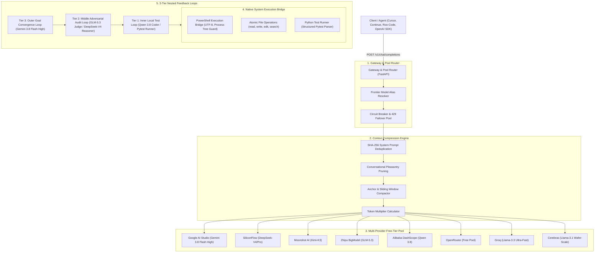

# Swarm Agent: Multi-Provider Token Gateway & Autonomous Swarm Runtime

[](https://opensource.org/licenses/MIT)
[](https://www.python.org/)
[](https://fastapi.tiangolo.com/)
[](https://github.com/)

**Swarm Agent** is a production-grade, zero-bloat, open-source local proxy gateway and autonomous multi-agent swarm runtime. It aggregates free-tier quotas across 8 frontier AI providers (Google AI Studio, SiliconFlow, Moonshot AI, Zhipu BigModel, Alibaba DashScope, OpenRouter, Groq, Cerebras), provides transparent HTTP 429 quota exhaustion failover, applies inline context compression to multiply daily token throughput, executes system commands natively on Windows, and orchestrates self-healing code synthesis through 3-tier nested feedback loops.

---

## Architecture Overview



---

## Free-Tier Provider Matrix

Swarm Agent unifies 8 frontier AI providers into a single high-availability pool. When any provider encounters rate limits (HTTP 429) or quota depletion, Swarm seamlessly routes requests to the next available provider in the chain without client disruption.

| Provider | Frontier Target Model | Free Quota / Limits | Failover Priority | Key Environment Variable | Pattern |
| :--- | :--- | :--- | :---: | :--- | :--- |
| **Google AI Studio** | `gemini-3.8-flash-high` | 15 RPM / 1M TPM / 1,500 RPD | 1 | `GEMINI_API_KEY` | `^AIzaSy[A-Za-z0-9_-]{33}$` |
| **SiliconFlow** | `deepseek-ai/DeepSeek-V4` | 60 RPM / 200k TPM / Free Balance | 1 | `SILICONFLOW_API_KEY` | `^sk-[a-zA-Z0-9]{32,64}$` |
| **Moonshot AI** | `kimi-k3` / `moonshot-v1-8k` | 30 RPM / 128k TPM / 1,000 RPD | 1 | `MOONSHOT_API_KEY` | `^sk-[a-zA-Z0-9]{40,64}$` |
| **Zhipu BigModel** | `glm-5.3` / `glm-4-flash` | 60 RPM / 200k TPM / 2,000 RPD | 1 | `ZHIPU_API_KEY` | `^([a-zA-Z0-9]+\.[a-zA-Z0-9]+|sk-.*)$` |
| **Alibaba DashScope**| `qwen-3.8` / `qwen-turbo` | 60 RPM / 180k TPM / 1,500 RPD | 1 | `DASHSCOPE_API_KEY` | `^sk-[a-zA-Z0-9]{32,48}$` |
| **OpenRouter** | `openrouter/auto` (Free pool) | 20 RPM / 50k TPM / 1,000 RPD | 2 | `OPENROUTER_API_KEY` | `^sk-or-v1-[a-f0-9]{64}$` |
| **Groq** | `llama-3.3-70b-versatile` | 30 RPM / 6,000 TPM / 14,400 RPD | 2 | `GROQ_API_KEY` | `^gsk_[a-zA-Z0-9]{48,64}$` |
| **Cerebras** | `llama3.1-8b` / `llama3.1-70b` | 30 RPM / 60,000 TPM / 14,400 RPD | 2 | `CEREBRAS_API_KEY` | `^csk-[a-zA-Z0-9]{48,64}$` |

---

## Frontier Model Aliases & Routing Fallbacks

Clients can request standard frontier model aliases. The gateway automatically resolves each alias to an ordered failover target chain:

| Requested Alias | Primary Route | Secondary Fallback | Tertiary Fallback |
| :--- | :--- | :--- | :--- |
| `deepseek-v4-pro` | `siliconflow/deepseek-ai/DeepSeek-V3` | `openrouter/deepseek/deepseek-r1:free` | `groq/llama-3.3-70b-versatile` |
| `kimi-k3` | `moonshot/moonshot-v1-32k` | `siliconflow/deepseek-ai/DeepSeek-V3` | `zhipu/glm-4-flash` |
| `glm-5.3` | `zhipu/glm-4-flash` | `siliconflow/THUDM/glm-4-9b-chat` | `openrouter/meta-llama/llama-3.3-70b-instruct:free` |
| `qwen-3.8` | `dashscope/qwen-plus` | `siliconflow/Qwen/Qwen2.5-7B-Instruct` | `openrouter/qwen/qwen-2.5-coder-32b-instruct:free` |
| `gemini-3.8-flash-high` | `google/gemini-2.5-flash` | `openrouter/google/gemini-2.0-flash-exp:free` | `groq/llama-3.3-70b-versatile` |
| `muse-spark` | `openrouter/meta-llama/llama-3.3-70b-instruct:free` | `cerebras/llama3.1-70b` | `siliconflow/Qwen/Qwen2.5-7B-Instruct` |

---

## Quickstart

### 1-Click Launch on Windows

Simply run the batch launcher:

```cmd
run_swarm.bat
```

The script automatically:
1. Validates that Python 3.10+ is installed on your machine.
2. Creates an isolated virtual environment (`.venv`).
3. Installs all required dependencies from `requirements.txt`.
4. Launches the interactive setup wizard if `config.json` is not found.
5. Starts the high-concurrency gateway server daemon.

### Interactive Configuration Wizard

You can run or re-run the setup wizard at any time:

```bash
run_swarm.bat --wizard
# or directly via python:
python -m swarm wizard
```

The wizard prompts for API keys, checks format regexes, tests active endpoint connectivity, and writes `config.json`.

### Connecting Your Editor / Agent Tools

Point your preferred tools to the local OpenAI endpoint:

- **Base URL:** `http://localhost:8000/v1`
- **API Key:** `any-string` (or configure `server.api_key_auth` in `config.json`)
- **Model:** `deepseek-v4-pro`, `kimi-k3`, `glm-5.3`, `qwen-3.8`, `gemini-3.8-flash-high`, or `muse-spark`

Compatible with:
- **Cursor** (Settings -> OpenAI API Key -> Override Base URL)
- **Continue.dev** (`config.json` apiBase: `http://localhost:8000/v1`)
- **Roo-Code / Cline** (Custom OpenAI provider)
- **Python / Node.js OpenAI SDK** (`client = OpenAI(base_url="http://localhost:8000/v1")`)

---

## Antigravity Integration (Temporary & Easily Removable)

Swarm Agent includes first-class temporary integration for Google Antigravity via an MCP Server (`swarm.mcp_server`) and Skill/Plugin (`swarm-agent-plugin`). This enables Antigravity to command the swarm across all 7 frontier models and unleash 3-tier feedback loops without manual configuration.

### 1-Click Attach (Temporary Testing)
```cmd
attach_to_antigravity.bat
```
- Backs up your existing `mcp_config.json` and `config.json`.
- Registers `swarm-agent` MCP stdio server with tools: `swarm_chat`, `swarm_run_autonomous_loop`, `swarm_model_catalog`, `swarm_system_status`, `swarm_powershell_exec`, and `swarm_compress_context`.
- Deploys `swarm-agent-plugin` with full agentic instructions.
- Automatically tests connection and verifies all 8 provider quotas.

### 1-Click Detach (Zero Residue)
```cmd
detach_from_antigravity.bat
```
- Restores original Antigravity configuration files.
- Removes `swarm-agent-plugin` directory completely.
- Leaves zero leftover files or settings.

---

## Standalone CLI Commands

The `swarm` CLI provides full management of the gateway and runtime:

```bash
# Start the gateway server daemon
python -m swarm start --host 127.0.0.1 --port 8000

# Inspect gateway health and circuit breaker states
python -m swarm status

# List registered frontier model aliases and routes
python -m swarm models

# Test inline context compression on prompt history
python -m swarm compress

# Run the automated pytest verification test suite
python -m swarm test -v
```

---

## Context Compression & Token Multiplication Engine (R2)

To maximize free-tier quota limits, Swarm Agent applies inline context compression before forwarding prompts to upstream providers:

1. **System Prompt Deduplication:** Hashes static instructions with SHA-256 and caches common prefixes.
2. **Pleasantry Stripping:** Removes redundant conversational greetings ("Sure, I can help with that!") and reasoning tags while strictly preserving code fences, JSON payloads, and identifiers.
3. **Sliding Window Compaction:** Preserves core system anchors and the most recent $K$ conversational turns while condensing intermediate turns.
4. **Token Multiplier Telemetry:** Measures uncompressed vs. compressed token volume and reports metrics via the `X-Swarm-Token-Multiplier` response header.

---

## Native System Execution Bridge (R3)

Swarm Agent includes a secure native execution suite allowing AI agents to perform tasks directly on the host machine:

- **PowerShell Execution Bridge:** Spawns `powershell.exe -NoProfile -ExecutionPolicy Bypass -Command` with UTF-8 encoding, dynamic admin privilege detection, configurable execution timeouts, and tree termination (`taskkill /F /T`).
- **Atomic File Management:** Sliceable `read_file`, atomic `write_file` (via temporary swap), single-block `edit_file`, directory listing, and regex file search.
- **Python Test Runner:** Subprocess test runner with structured traceback and assertion failure parsing.
- **Safety Guardrails:** Workspace root boundary checks and blocked dangerous command patterns (`Format-Volume`, `Stop-Computer`, recursive root deletions).

---

## 3-Tier Nested Feedback & Autonomous Convergence Loops (R5)

Swarm Agent implements an autonomous, self-correcting multi-agent feedback engine:

1. **Tier 1 (Inner Local Test Loop):** Subprocess-level test execution (`pytest`), deterministic traceback parsing, and rapid self-repair cycles with a hard 5-attempt budget until clean exit code 0 is reached.
2. **Tier 2 (Middle Adversarial Audit Loop):** Independent adversarial review by Judge persona (**GLM-5.3**) evaluating specification compliance, security isolation, and fault tolerance. Rejections trigger root-cause derivation by Reasoner (**DeepSeek-V4-Pro**) and code generation by Coder (**Qwen 3.8**).
3. **Tier 3 (Outer Goal Convergence Loop):** Persistent state machine led by Chief Architect (**Gemini 3.8 Flash High**) tracking milestone progression, atomic disk persistence via `checkpoint.json`, and cold-boot crash recovery.

---

## Verification & Automated Test Suite

Run the full automated test suite verifying all milestones:

```bash
# Via batch launcher
run_swarm.bat --test

# Or via pytest directly
pytest -v tests/
```

Test suite coverage:
- `tests/test_gateway.py`: OpenAI proxy, streaming SSE chunks, 429 quota exhaustion, transparent multi-provider failover.
- `tests/test_compression.py`: System prompt hashing, pleasantry pruning, sliding window compaction, token multiplier calculation.
- `tests/test_tools.py`: PowerShell bridge, UTF-8 handling, timeout cleanup, atomic file operations, pytest structured failure parsing.
- `tests/test_convergence_loop.py`: Tier 1 self-healing loop, Tier 2 adversarial judge audit & re-derivation, Tier 3 milestone checkpoint persistence and crash recovery.

---

## Repository Structure

```
├── run_swarm.bat               # One-click Windows distribution launcher
├── requirements.txt            # Production-pinned zero-bloat dependencies
├── config.example.json         # Complete 8-provider configuration template
├── README.md                   # Project documentation
├── LICENSE                     # MIT license
├── checkpoint.json             # Runtime goal convergence state persistence
├── swarm/
│   ├── config.py               # Settings loader (config.json + env fallback)
│   ├── main.py                 # FastAPI ASGI gateway server
│   ├── cli/
│   │   ├── __init__.py         # CLI module exports
│   │   ├── wizard.py           # Interactive Rich setup wizard
│   │   └── client.py           # Standalone CLI commands (start, status, models, test, compress)
│   ├── core/
│   │   ├── models.py           # OpenAI-compatible Pydantic schemas
│   │   └── exceptions.py       # Standardized error hierarchy
│   ├── providers/              # 8 Provider adapters (Google, SiliconFlow, Moonshot,
│   │                           # Zhipu, DashScope, OpenRouter, Groq, Cerebras)
│   ├── router/                 # Circuit breaker & failover pool
│   ├── compression/            # Prompt deduplication & sliding window compactor
│   ├── tools/                  # PowerShell execution bridge & file suite
│   └── loops/                  # 3-Tier nested feedback convergence engine
└── tests/                      # Automated verification test suite
```

---

## License

This project is licensed under the terms of the [MIT License](LICENSE).
